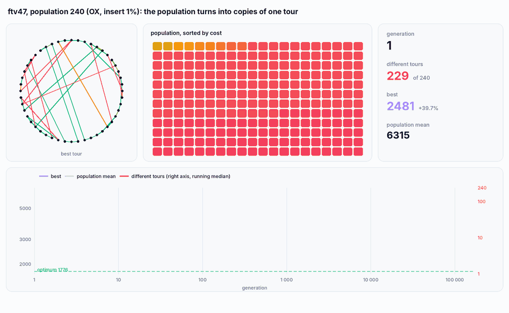
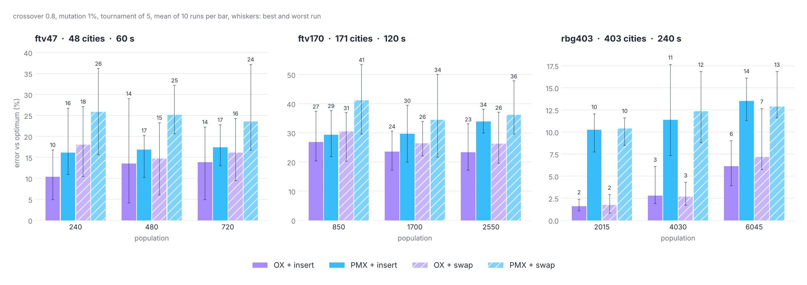

<p align="right">
  <a href="README.md"> <b>English</b></a>
  &nbsp;|&nbsp;
  <a href="README.pl.md"> Polski</a>
</p>

<a href="#see-it-in-action">
  <picture>
    <source media="(prefers-color-scheme: dark)" srcset="docs/banner-en-dark.svg" />
    <source media="(prefers-color-scheme: light)" srcset="docs/banner-en-light.svg" />
    
  </picture>
</a>

<p align="center">
  
  
  
  
  
</p>

<p align="center">
  <a href="#see-it-in-action"><b>Demo</b></a> &nbsp;·&nbsp;
  <a href="#how-it-works"><b>How it works</b></a> &nbsp;·&nbsp;
  <a href="#results"><b>Results</b></a> &nbsp;·&nbsp;
  <a href="#why-it-stops-improving"><b>Why it stalls</b></a> &nbsp;·&nbsp;
  <a href="#getting-started"><b>Getting started</b></a> &nbsp;·&nbsp;
  <a href="#project-structure"><b>Structure</b></a>
</p>

**ATSP: Genetic Algorithm** is the fourth and last project for the *Design of Efficient Algorithms* course (*Projektowanie Efektywnych Algorytmów*) at Wrocław University of Science and Technology, after [brute force and heuristics](https://github.com/Nurek54/ATSP-Brute-Force-vs-Heuristics), [branch and bound](https://github.com/Nurek54/ATSP-Branch-and-Bound) and [Tabu Search vs Simulated Annealing](https://github.com/Nurek54/ATSP-Tabu-Search-vs-Simulated-Annealing). It solves the **asymmetric travelling salesman problem** with a **genetic algorithm**: tournament selection, two crossovers (**OX** and **PMX**), three mutations (**swap**, **insert**, **reverse**), on the same TSPLIB instances as the previous project, `ftv47`, `ftv170` and `rbg403`, whose optima are known.

A config file sets the population size, the crossover and mutation operators and rates, and the time limit; every run appends its parameters, time, cost and tour to a CSV file. `tools/benchmark` repeats the course experiment automatically.

## See it in action

<p align="center">
  <picture>
    <source media="(prefers-color-scheme: dark)" srcset="docs/en/population-dark.gif" />
    <source media="(prefers-color-scheme: light)" srcset="docs/en/population-light.gif" />
    
  </picture>
</p>

<p align="center"><sub>One 20-second run on <code>ftv47</code> (population 240, OX, insert mutation 1%), recorded from the C++ code with an instrumented copy that logs every population. Each square is one tour coloured by its cost. The cities on the circle are placed in the order of an optimal tour, so the optimum is the circle itself. The x axis of the chart is logarithmic: the first 100 generations take about a tenth of a second, the whole run 172 700 generations.</sub></p>

## Highlights

<table>
  <tr>
    <td width="25%" align="center"><h3>~50</h3><sub>generations until 240 tours shrink<br/>to a handful of different ones</sub></td>
    <td width="25%" align="center"><h3>OX</h3><sub>beats PMX on every instance,<br/>by 6 to 8 percentage points</sub></td>
    <td width="25%" align="center"><h3>1.6%</h3><sub>mean error on rbg403<br/>(403 cities) with OX</sub></td>
    <td width="25%" align="center"><h3>360</h3><sub>runs in the original experiment,<br/>60 to 240 s each</sub></td>
  </tr>
</table>

- **Real benchmark instances.** `ftv47` (48 cities), `ftv170` (171) and `rbg403` (403) from TSPLIB, with optima 1776, 2755 and 2465, so every result is given as a percentage above the optimum.
- **Configurable operators.** Crossover OX or PMX, mutation swap, insert or reverse, population size and both rates, all from `config/config.txt`.
- **Cost-aware mutation.** The positions to mutate are drawn with probability proportional to the cost of the edge leaving them, so expensive edges are changed more often.
- **Original measurements included.** `results/` holds the CSV files from the course experiment; the charts below are made from them.

## How it works

| Step | What the code does |
|---|---|
| Start | `population_size` random permutations, one of them replaced by a nearest-neighbour tour from a random city |
| Selection | tournament of 5 random tours, the cheapest wins; done twice for each pair of parents |
| Crossover | with probability `crossover_rate` the pair is crossed, otherwise both parents are copied |
| Mutation | each child is mutated with probability `mutation_rate`; positions are drawn by the cost of their outgoing edge |
| Replacement | the children replace the whole population; the best tour ever found is kept aside |
| Stop | `time_limit` seconds or `max_generations` |

| Operator | What it does |
|---|---|
| **OX** (order crossover) | copies a random segment from parent 1 in place, then fills the rest with the cities of parent 2 in the order they appear after the segment, wrapping around |
| **PMX** (as implemented) | copies the same kind of segment, then fills the free positions from left to right with the cities of parent 2 in order. This is not the textbook PMX (there is no mapping between the segments); it behaves like OX that always starts filling at position 0 |
| **swap** | swaps two cities, both chosen by edge cost |
| **insert** | moves one city (chosen by edge cost) to a random position |
| **reverse** | reverses the segment between two positions chosen by edge cost |

## Results

The experiment from the course: for each instance, three population sizes (5, 10 and 15 times the number of cities), both crossovers and two mutations, 10 runs per setting, crossover rate 0.8, mutation rate 1%, time limit 60 s for ftv47, 120 s for ftv170 and 240 s for rbg403. **360 runs**, measured on Windows with the final version of the code (the CSV files are in `results/`).

<p align="center">
  <picture>
    <source media="(prefers-color-scheme: dark)" srcset="docs/en/results-dark.png" />
    <source media="(prefers-color-scheme: light)" srcset="docs/en/results-light.png" />
    
  </picture>
</p>

Mean error above the optimum over 10 runs:

| Instance | Population | OX + insert | PMX + insert | OX + swap | PMX + swap |
|---|---|---|---|---|---|
| ftv47 | 240 | **10.4%** | 16.1% | 18.0% | 25.9% |
| ftv47 | 480 | 13.5% | 16.9% | 14.7% | 25.2% |
| ftv47 | 720 | 13.8% | 17.4% | 16.1% | 23.5% |
| ftv170 | 850 | 26.9% | 29.4% | 30.5% | 41.2% |
| ftv170 | 1700 | 23.5% | 29.6% | 26.5% | 34.4% |
| ftv170 | 2550 | **23.4%** | 33.9% | 26.3% | 36.2% |
| rbg403 | 2015 | **1.6%** | 10.3% | 1.7% | 10.4% |
| rbg403 | 4030 | 2.8% | 11.4% | 2.7% | 12.3% |
| rbg403 | 6045 | 6.1% | 13.5% | 7.2% | 12.9% |

What the measurements show:

- **OX is clearly better than PMX.** Averaged over all settings: 14.4% against 20.8% on ftv47, 26.2% against 34.1% on ftv170 and 3.7% against 11.8% on rbg403. A tour is a cycle, and OX keeps the order of parent 2 starting right after the copied segment, so the edge at the end of the segment usually survives. The left-to-right fill of PMX breaks that order at an arbitrary point. PMX is also about twice as slow per generation (it searches for the next free position from the start every time), so in the same time it makes half as many generations.
- **Insert is better than swap**: on average by 6 points on ftv47 and 5 on ftv170; on rbg403 they are equal (7.6% and 7.9%).
- **Population size has no single best value.** On ftv47 the smallest population is best, on ftv170 the larger ones, and on rbg403 the largest is clearly worst: with 6 045 tours of 403 cities each, 240 seconds is only enough for about 3 000 generations, a third of what the smallest population gets.
- **Crossover and mutation rates matter little.** On ftv47 and ftv170 crossover rates of 0.5, 0.7 and 0.9 change the mean by up to 4 points without a consistent direction; raising the mutation rate from 1% to 5% or 10% on ftv47 lowers the mean from 13.5% to 10.5%. The best ftv170 setting in the whole experiment (21.9%) used crossover at only 5% and mutation at 80%, so the algorithm worked mostly as many parallel local searches.
- **The genetic algorithm is the weakest of the course's metaheuristics.** With 60 to 240 s it stays 10.4% above the optimum on ftv47, 23.4% on ftv170 and 1.6% on rbg403. Tabu Search and Simulated Annealing from the [previous project](https://github.com/Nurek54/ATSP-Tabu-Search-vs-Simulated-Annealing) reached 0.7%, 11.6% and 0.3% in under a minute.

### Reproducing it

`tools/benchmark` runs the same population and crossover grid plus swap and reverse mutations, 5 runs per setting with shorter limits (20, 40 and 80 s), on the current code. On Linux (`-O2`, one core) it confirms the main result:

| Instance | OX + insert, mean of 3 populations | PMX + insert, mean of 3 populations | Generations per run, OX / PMX (smallest population) |
|---|---|---|---|
| ftv47 | 12.8% | 15.0% | 143 700 / 62 100 |
| ftv170 | 22.8% | 30.9% | 15 600 / 7 100 |
| rbg403 | 2.1% | 7.4% | 2 800 / 1 400 |

## Why it stops improving

The animation above shows the problem directly: on ftv47 with 240 tours, the population holds **229 different tours in generation 1, 139 in generation 10 and 7 in generation 50**, and the mean cost of the population is then within 0.2% of the best one. From there on the run is 170 000 generations of the same tour copied over and over, with an occasional mutant that dies out again. The best tour of the whole run, 2 099, was already found by generation 300.

- **The selection pressure is very high.** Every parent is the best of 5 tours drawn from the whole population. The best tour wins every tournament it is drawn into, so it becomes a parent about five times per generation, and its copies fill the population within a few dozen generations.
- **There is nothing to keep the population diverse.** Crossing two copies of the same tour gives the same tour again, and with a 1% mutation rate only about two children per generation are changed at all.
- **More time does not help.** Short runs of 500 generations (about 0.3 s, population 1 000, crossover 0.9) reach 11.4% on ftv47 with 10% mutation and 13.6% with 1%, the same range as 20 to 60 second runs. Raising the mutation rate keeps about 100 different tours instead of 20, but almost all of them are small variations of the same one.

## Getting started

<p align="center">
  
</p>

**CLion:** open the folder and run `atsp_ga`.

**Command line:**

```bash
cmake -S . -B build -DCMAKE_BUILD_TYPE=Release
cmake --build build
./build/atsp_ga                     # config/config.txt
./build/atsp_ga my_config.txt       # any other config
```

Without an argument the program reads `config.txt` from the working directory and, if there is none, `config/config.txt` from the project. The matrix file is looked up in the working directory and then in `data/`. The program prints every new best tour and the number of generations at the end. Messages in the program are in Polish.

### Config

```ini
algorithm = genetic             # the only one available
algorithm_runs = 1              # how many times to repeat the run
matrix_file = ftv47.atsp        # ftv47.atsp, ftv170.atsp, rbg403.atsp or any TSPLIB FULL_MATRIX file
time_limit = 30                 # seconds per run

population_size = 240           # the course used 5, 10 and 15 times the number of cities
crossover_rate = 0.8
mutation_rate = 0.01
crossover_method = OX           # OX / PMX
mutation_method = insert        # swap / insert / reverse
selection_method = tournament   # always a tournament of 5
max_generations = 9000000

log_file = results.csv          # every run appends one line
```

The CSV columns are `Algorithm, PopulationSize, CrossoverRate, MutationRate, CrossoverMethod, MutationMethod, SelectionMethod, MaxGenerations, Seconds, Milliseconds, BestCost, BestSolution`.

### Running the benchmark

```bash
./build/benchmark                  # 5 runs per setting, limits 30 / 60 / 120 s
./build/benchmark 5 20 > grid.csv  # the shorter limits used for the table above (20 / 40 / 80 s)
./build/benchmark 10 60 ftv47      # one instance
```

The arguments are the number of runs, the time limit for ftv47 in seconds (ftv170 gets twice and rbg403 four times as much) and an optional instance. The output is CSV: `instance,n,optimum,experiment,population,crossover,mutation,run,seconds,generations,cost`. With the defaults the full grid takes about two and a half hours on one core.

## Project structure

```
.
├── src/
│   ├── main.cpp
│   ├── app/            # ConfigReader
│   ├── core/           # TSPInstance (TSPLIB reader), TSPUtilities
│   ├── algorithms/     # GeneticAlgorithm
│   └── io/             # SaveToCSV
├── config/             # config.txt
├── data/               # ftv47.atsp, ftv170.atsp, rbg403.atsp (TSPLIB)
├── results/            # the original measurements from the course (January 2025, Windows)
├── tools/benchmark.cpp # population, crossover and mutation grid, CSV output
└── docs/               # README visuals (EN / PL, light / dark)
```

<details>
<summary><b>Notes on the code</b></summary>
<br/>

- **The PMX crossover is not PMX.** It never builds the mapping between the two segments; it fills the free positions left to right with parent 2's cities in order. The children are always valid permutations, so nothing breaks, but the name is misleading.
- `selection_method` in the config is read but ignored: selection is always a tournament of 5. Roulette selection is not implemented.
- There is no elitism: the whole population is replaced every generation and the best tour lives only in a separate variable. Copying it back into the population would keep it available to the crossover.
- Every generation allocates a new population (`population_size` arrays of `n` ints) and frees the old one; two buffers swapped between generations would avoid that.
- `results/` holds the original CSV files. In `GA_ftv170_mutacje.csv` the crossover rate is 0.05 and 0.10 and the mutation rate 0.8, the reverse of the ftv47 file; both are reported as they were run.

</details>

---

<p align="center">
  <sub>Wrocław University of Science and Technology · Design of Efficient Algorithms · Grzegorz Sienkiewicz</sub>
</p>
