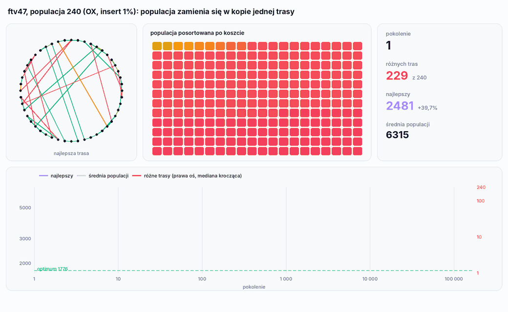
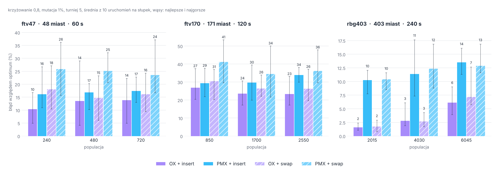

<p align="right">
  <a href="README.md"> English</a>
  &nbsp;|&nbsp;
  <a href="README.pl.md"> <b>Polski</b></a>
</p>

<a href="#zobacz-jak-działa">
  <picture>
    <source media="(prefers-color-scheme: dark)" srcset="docs/banner-pl-dark.svg" />
    <source media="(prefers-color-scheme: light)" srcset="docs/banner-pl-light.svg" />
    
  </picture>
</a>

<p align="center">
  
  
  
  
  
</p>

<p align="center">
  <a href="#zobacz-jak-działa"><b>Demo</b></a> &nbsp;·&nbsp;
  <a href="#jak-to-działa"><b>Jak to działa</b></a> &nbsp;·&nbsp;
  <a href="#wyniki"><b>Wyniki</b></a> &nbsp;·&nbsp;
  <a href="#dlaczego-przestaje-się-poprawiać"><b>Dlaczego staje</b></a> &nbsp;·&nbsp;
  <a href="#uruchomienie"><b>Uruchomienie</b></a> &nbsp;·&nbsp;
  <a href="#struktura-projektu"><b>Struktura</b></a>
</p>

**ATSP: Genetic Algorithm** to czwarty i ostatni projekt z kursu *Projektowanie Efektywnych Algorytmów* na Politechnice Wrocławskiej, po [przeglądzie zupełnym i heurystykach](https://github.com/Nurek54/ATSP-Brute-Force-vs-Heuristics), [metodzie podziału i ograniczeń](https://github.com/Nurek54/ATSP-Branch-and-Bound) oraz [Tabu Search i symulowanym wyżarzaniu](https://github.com/Nurek54/ATSP-Tabu-Search-vs-Simulated-Annealing). Rozwiązuje **asymetryczny problem komiwojażera** **algorytmem genetycznym**: selekcja turniejowa, dwa krzyżowania (**OX** i **PMX**), trzy mutacje (**swap**, **insert**, **reverse**), na tych samych instancjach TSPLIB co poprzedni projekt, `ftv47`, `ftv170` i `rbg403`, o znanych optimach.

Plik konfiguracyjny ustawia rozmiar populacji, operatory i prawdopodobieństwa krzyżowania i mutacji oraz limit czasu; każde uruchomienie dopisuje parametry, czas, koszt i trasę do pliku CSV. `tools/benchmark` automatycznie powtarza eksperyment z kursu.

## Zobacz, jak działa

<p align="center">
  <picture>
    <source media="(prefers-color-scheme: dark)" srcset="docs/pl/population-dark.gif" />
    <source media="(prefers-color-scheme: light)" srcset="docs/pl/population-light.gif" />
    
  </picture>
</p>

<p align="center"><sub>Jedno 20-sekundowe uruchomienie na <code>ftv47</code> (populacja 240, OX, mutacja insert 1%), zapisane z kodu C++ przez instrumentowaną kopię, która loguje każdą populację. Każdy kwadrat to jedna trasa w kolorze jej kosztu. Miasta na okręgu są ułożone w kolejności trasy optymalnej, więc optimum to sam okrąg. Oś x wykresu jest logarytmiczna: pierwsze 100 pokoleń zajmuje około jednej dziesiątej sekundy, całe uruchomienie 172 700 pokoleń.</sub></p>

## W skrócie

<table>
  <tr>
    <td width="25%" align="center"><h3>~50</h3><sub>pokoleń, po których z 240 tras<br/>zostaje kilka różnych</sub></td>
    <td width="25%" align="center"><h3>OX</h3><sub>wygrywa z PMX na każdej instancji<br/>o 6 do 8 punktów procentowych</sub></td>
    <td width="25%" align="center"><h3>1,6%</h3><sub>średni błąd na rbg403<br/>(403 miasta) z OX</sub></td>
    <td width="25%" align="center"><h3>360</h3><sub>uruchomień w oryginalnym eksperymencie,<br/>po 60 do 240 s</sub></td>
  </tr>
</table>

- **Prawdziwe instancje testowe.** `ftv47` (48 miast), `ftv170` (171) i `rbg403` (403) z TSPLIB, z optimami 1776, 2755 i 2465, więc każdy wynik jest podany jako procent powyżej optimum.
- **Konfigurowalne operatory.** Krzyżowanie OX albo PMX, mutacja swap, insert albo reverse, rozmiar populacji i oba prawdopodobieństwa, wszystko z `config/config.txt`.
- **Mutacja świadoma kosztów.** Pozycje do mutacji są losowane z prawdopodobieństwem proporcjonalnym do kosztu krawędzi, która z nich wychodzi, więc drogie krawędzie zmieniają się częściej.
- **Oryginalne pomiary w repozytorium.** `results/` zawiera pliki CSV z eksperymentu na kursie; wykresy poniżej są z nich zrobione.

## Jak to działa

| Krok | Co robi kod |
|---|---|
| Start | `population_size` losowych permutacji, z których jedna jest zastąpiona trasą najbliższego sąsiada z losowego miasta |
| Selekcja | turniej 5 losowych tras, wygrywa najtańsza; dwa razy na każdą parę rodziców |
| Krzyżowanie | z prawdopodobieństwem `crossover_rate` para jest krzyżowana, w przeciwnym razie oboje rodzice są kopiowani |
| Mutacja | każde dziecko jest mutowane z prawdopodobieństwem `mutation_rate`; pozycje są losowane według kosztu krawędzi wychodzącej |
| Wymiana | dzieci zastępują całą populację; najlepsza znaleziona trasa jest trzymana osobno |
| Koniec | `time_limit` sekund albo `max_generations` |

| Operator | Co robi |
|---|---|
| **OX** (order crossover) | kopiuje losowy odcinek z rodzica 1 na to samo miejsce, a resztę wypełnia miastami rodzica 2 w kolejności, w jakiej występują za odcinkiem, z zawinięciem |
| **PMX** (w tej implementacji) | kopiuje taki sam odcinek, a wolne pozycje wypełnia od lewej do prawej miastami rodzica 2 po kolei. To nie jest podręcznikowy PMX (nie ma mapowania między odcinkami); działa jak OX, który zawsze zaczyna wypełnianie od pozycji 0 |
| **swap** | zamienia dwa miasta, oba wybrane według kosztu krawędzi |
| **insert** | przenosi jedno miasto (wybrane według kosztu krawędzi) na losową pozycję |
| **reverse** | odwraca odcinek między dwiema pozycjami wybranymi według kosztu krawędzi |

## Wyniki

Eksperyment z kursu: dla każdej instancji trzy rozmiary populacji (5, 10 i 15 razy liczba miast), oba krzyżowania i dwie mutacje, 10 uruchomień na ustawienie, krzyżowanie 0,8, mutacja 1%, limit czasu 60 s dla ftv47, 120 s dla ftv170 i 240 s dla rbg403. **360 uruchomień** zmierzonych na Windowsie na ostatecznej wersji kodu (pliki CSV są w `results/`).

<p align="center">
  <picture>
    <source media="(prefers-color-scheme: dark)" srcset="docs/pl/results-dark.png" />
    <source media="(prefers-color-scheme: light)" srcset="docs/pl/results-light.png" />
    
  </picture>
</p>

Średni błąd powyżej optimum z 10 uruchomień:

| Instancja | Populacja | OX + insert | PMX + insert | OX + swap | PMX + swap |
|---|---|---|---|---|---|
| ftv47 | 240 | **10,4%** | 16,1% | 18,0% | 25,9% |
| ftv47 | 480 | 13,5% | 16,9% | 14,7% | 25,2% |
| ftv47 | 720 | 13,8% | 17,4% | 16,1% | 23,5% |
| ftv170 | 850 | 26,9% | 29,4% | 30,5% | 41,2% |
| ftv170 | 1700 | 23,5% | 29,6% | 26,5% | 34,4% |
| ftv170 | 2550 | **23,4%** | 33,9% | 26,3% | 36,2% |
| rbg403 | 2015 | **1,6%** | 10,3% | 1,7% | 10,4% |
| rbg403 | 4030 | 2,8% | 11,4% | 2,7% | 12,3% |
| rbg403 | 6045 | 6,1% | 13,5% | 7,2% | 12,9% |

Co pokazują pomiary:

- **OX jest wyraźnie lepsze od PMX.** Średnio po wszystkich ustawieniach: 14,4% wobec 20,8% na ftv47, 26,2% wobec 34,1% na ftv170 i 3,7% wobec 11,8% na rbg403. Trasa jest cyklem, a OX zachowuje kolejność rodzica 2 zaczynając zaraz za skopiowanym odcinkiem, więc krawędź na końcu odcinka zwykle przeżywa. Wypełnianie od lewej w PMX przerywa tę kolejność w przypadkowym miejscu. PMX jest też mniej więcej dwa razy wolniejsze na pokolenie (za każdym razem szuka wolnej pozycji od początku), więc w tym samym czasie robi o połowę mniej pokoleń.
- **Insert jest lepszy od swap**: średnio o 6 punktów na ftv47 i 5 na ftv170; na rbg403 są równe (7,6% i 7,9%).
- **Nie ma jednego najlepszego rozmiaru populacji.** Na ftv47 najlepsza jest najmniejsza populacja, na ftv170 większe, a na rbg403 największa jest wyraźnie najgorsza: przy 6 045 trasach po 403 miasta 240 sekund wystarcza tylko na około 3 000 pokoleń, jedną trzecią tego, co dostaje najmniejsza populacja.
- **Prawdopodobieństwa krzyżowania i mutacji mają małe znaczenie.** Na ftv47 i ftv170 krzyżowanie 0,5, 0,7 i 0,9 zmienia średnią o najwyżej 4 punkty bez stałego kierunku; podniesienie mutacji z 1% do 5% lub 10% na ftv47 obniża średnią z 13,5% do 10,5%. Najlepsze ustawienie ftv170 w całym eksperymencie (21,9%) miało krzyżowanie tylko 5% i mutację 80%, więc algorytm działał głównie jak wiele równoległych przeszukiwań lokalnych.
- **Algorytm genetyczny jest najsłabszą z metaheurystyk z kursu.** Przy 60 do 240 s zostaje 10,4% powyżej optimum na ftv47, 23,4% na ftv170 i 1,6% na rbg403. Tabu Search i symulowane wyżarzanie z [poprzedniego projektu](https://github.com/Nurek54/ATSP-Tabu-Search-vs-Simulated-Annealing) osiągnęły 0,7%, 11,6% i 0,3% w niecałą minutę.

### Powtórzenie pomiarów

`tools/benchmark` uruchamia tę samą siatkę populacji i krzyżowań oraz mutacje swap i reverse, po 5 uruchomień na ustawienie z krótszymi limitami (20, 40 i 80 s), na obecnym kodzie. Na Linuksie (`-O2`, jeden rdzeń) potwierdza główny wynik:

| Instancja | OX + insert, średnia z 3 populacji | PMX + insert, średnia z 3 populacji | Pokoleń na uruchomienie, OX / PMX (najmniejsza populacja) |
|---|---|---|---|
| ftv47 | 12,8% | 15,0% | 143 700 / 62 100 |
| ftv170 | 22,8% | 30,9% | 15 600 / 7 100 |
| rbg403 | 2,1% | 7,4% | 2 800 / 1 400 |

## Dlaczego przestaje się poprawiać

Animacja powyżej pokazuje problem wprost: na ftv47 z populacją 240 w pokoleniu 1 jest **229 różnych tras, w pokoleniu 10 już 139, a w pokoleniu 50 tylko 7**, a średni koszt populacji jest wtedy w granicach 0,2% od najlepszego. Od tego momentu uruchomienie to 170 000 pokoleń tej samej trasy kopiowanej w kółko, z pojedynczymi mutantami, które zaraz znikają. Najlepsza trasa całego uruchomienia, 2 099, była znaleziona już do 300. pokolenia.

- **Presja selekcyjna jest bardzo duża.** Każdy rodzic to najlepsza z 5 tras wylosowanych z całej populacji. Najlepsza trasa wygrywa każdy turniej, do którego trafi, więc zostaje rodzicem średnio pięć razy na pokolenie, a jej kopie wypełniają populację w kilkadziesiąt pokoleń.
- **Nic nie podtrzymuje różnorodności.** Skrzyżowanie dwóch kopii tej samej trasy daje znowu tę samą trasę, a przy mutacji 1% w każdym pokoleniu zmieniane są tylko około dwa dzieci.
- **Więcej czasu nie pomaga.** Krótkie uruchomienia po 500 pokoleń (około 0,3 s, populacja 1 000, krzyżowanie 0,9) dochodzą na ftv47 do 11,4% z mutacją 10% i 13,6% z mutacją 1%, czyli do tego samego poziomu co uruchomienia po 20 do 60 sekund. Wyższa mutacja utrzymuje około 100 różnych tras zamiast 20, ale prawie wszystkie to drobne odmiany tej samej.

## Uruchomienie

<p align="center">
  
</p>

**CLion:** otwórz folder i uruchom `atsp_ga`.

**Wiersz poleceń:**

```bash
cmake -S . -B build -DCMAKE_BUILD_TYPE=Release
cmake --build build
./build/atsp_ga                     # config/config.txt
./build/atsp_ga moj_config.txt      # dowolny inny plik konfiguracyjny
```

Bez argumentu program czyta `config.txt` z katalogu roboczego, a jeśli go tam nie ma, `config/config.txt` z projektu. Plik z macierzą jest szukany w katalogu roboczym, a potem w `data/`. Program wypisuje każdą nową najlepszą trasę, a na końcu liczbę pokoleń.

### Konfiguracja

```ini
algorithm = genetic             # jedyny dostępny
algorithm_runs = 1              # ile razy powtórzyć uruchomienie
matrix_file = ftv47.atsp        # ftv47.atsp, ftv170.atsp, rbg403.atsp albo dowolny plik TSPLIB FULL_MATRIX
time_limit = 30                 # sekundy na jedno uruchomienie

population_size = 240           # na kursie 5, 10 i 15 razy liczba miast
crossover_rate = 0.8
mutation_rate = 0.01
crossover_method = OX           # OX / PMX
mutation_method = insert        # swap / insert / reverse
selection_method = tournament   # zawsze turniej 5
max_generations = 9000000

log_file = results.csv          # każde uruchomienie dopisuje jedną linię
```

Kolumny CSV to `Algorithm, PopulationSize, CrossoverRate, MutationRate, CrossoverMethod, MutationMethod, SelectionMethod, MaxGenerations, Seconds, Milliseconds, BestCost, BestSolution`.

### Benchmark

```bash
./build/benchmark                  # 5 uruchomień na ustawienie, limity 30 / 60 / 120 s
./build/benchmark 5 20 > grid.csv  # krótsze limity użyte w tabeli wyżej (20 / 40 / 80 s)
./build/benchmark 10 60 ftv47      # jedna instancja
```

Argumenty to liczba uruchomień, limit czasu dla ftv47 w sekundach (ftv170 dostaje dwa, a rbg403 cztery razy więcej) i opcjonalnie instancja. Wynik to CSV: `instance,n,optimum,experiment,population,crossover,mutation,run,seconds,generations,cost`. Przy domyślnych ustawieniach pełna siatka trwa około dwóch i pół godziny na jednym rdzeniu.

## Struktura projektu

```
.
├── src/
│   ├── main.cpp
│   ├── app/            # ConfigReader
│   ├── core/           # TSPInstance (czytnik TSPLIB), TSPUtilities
│   ├── algorithms/     # GeneticAlgorithm
│   └── io/             # SaveToCSV
├── config/             # config.txt
├── data/               # ftv47.atsp, ftv170.atsp, rbg403.atsp (TSPLIB)
├── results/            # oryginalne pomiary z kursu (styczeń 2025, Windows)
├── tools/benchmark.cpp # siatka populacji, krzyżowań i mutacji, wynik w CSV
└── docs/               # grafiki do README (EN / PL, jasne / ciemne)
```

<details>
<summary><b>Uwagi do kodu</b></summary>
<br/>

- **Krzyżowanie PMX nie jest PMX.** Nigdy nie buduje mapowania między odcinkami; wypełnia wolne pozycje od lewej miastami rodzica 2 po kolei. Dzieci są zawsze poprawnymi permutacjami, więc nic się nie psuje, ale nazwa wprowadza w błąd.
- `selection_method` z konfiguracji jest wczytywane, ale pomijane: selekcja to zawsze turniej 5. Selekcja ruletkowa nie jest zaimplementowana.
- Nie ma elityzmu: cała populacja jest wymieniana w każdym pokoleniu, a najlepsza trasa żyje tylko w osobnej zmiennej. Wkładanie jej z powrotem do populacji zostawiłoby ją dostępną dla krzyżowania.
- Każde pokolenie alokuje nową populację (`population_size` tablic po `n` liczb) i zwalnia starą; dwa bufory zamieniane między pokoleniami by tego uniknęły.
- `results/` zawiera oryginalne pliki CSV. W `GA_ftv170_mutacje.csv` krzyżowanie wynosi 0,05 i 0,10, a mutacja 0,8, odwrotnie niż w pliku dla ftv47; oba są opisane tak, jak zostały uruchomione.

</details>

---

<p align="center">
  <sub>Politechnika Wrocławska · Projektowanie Efektywnych Algorytmów · Grzegorz Sienkiewicz</sub>
</p>
